  <picture><source media="(prefers-color-scheme: dark)" srcset="assets/hero-dark.svg"><source media="(prefers-color-scheme: light)" srcset="assets/hero-light.svg"></picture>

  <picture><source media="(prefers-color-scheme: dark)" srcset="assets/footer-dark.svg"><source media="(prefers-color-scheme: light)" srcset="assets/footer-light.svg"></picture>

<!-- Generated by scripts/build.py, README included: edit the data there and run
     uv run --no-project --with fonttools --with uharfbuzz python scripts/build.py -->
