  <picture>
    <source media="(prefers-color-scheme: dark)" srcset="assets/hero-dark.svg">
    <source media="(prefers-color-scheme: light)" srcset="assets/hero-light.svg">
    
  </picture>

  I build AI that runs on the machine in front of you — and decides what is allowed to leave it.

 

<picture>
  <source media="(prefers-color-scheme: dark)" srcset="assets/rule-projects-dark.svg">
  <source media="(prefers-color-scheme: light)" srcset="assets/rule-projects-light.svg">
  
</picture>

  <a href="https://github.com/Lang-Julian/pidigit"><picture>
    <source media="(prefers-color-scheme: dark)" srcset="assets/card-pidigit-dark.svg">
    <source media="(prefers-color-scheme: light)" srcset="assets/card-pidigit-light.svg">
    
  </picture></a>
  <a href="https://github.com/Lang-Julian/glyphfall"><picture>
    <source media="(prefers-color-scheme: dark)" srcset="assets/card-glyphfall-dark.svg">
    <source media="(prefers-color-scheme: light)" srcset="assets/card-glyphfall-light.svg">
    
  </picture></a>
  <a href="https://github.com/Lang-Julian/claude-tower"><picture>
    <source media="(prefers-color-scheme: dark)" srcset="assets/card-claude-tower-dark.svg">
    <source media="(prefers-color-scheme: light)" srcset="assets/card-claude-tower-light.svg">
    
  </picture></a>
  <a href="https://github.com/Lang-Julian/facettn"><picture>
    <source media="(prefers-color-scheme: dark)" srcset="assets/card-facettn-dark.svg">
    <source media="(prefers-color-scheme: light)" srcset="assets/card-facettn-light.svg">
    
  </picture></a>
  <a href="https://github.com/Lang-Julian/ct"><picture>
    <source media="(prefers-color-scheme: dark)" srcset="assets/card-ct-dark.svg">
    <source media="(prefers-color-scheme: light)" srcset="assets/card-ct-light.svg">
    
  </picture></a>
  <a href="https://github.com/Lang-Julian/price-globe"><picture>
    <source media="(prefers-color-scheme: dark)" srcset="assets/card-price-globe-dark.svg">
    <source media="(prefers-color-scheme: light)" srcset="assets/card-price-globe-light.svg">
    
  </picture></a>

 

<picture>
  <source media="(prefers-color-scheme: dark)" srcset="assets/rule-activity-dark.svg">
  <source media="(prefers-color-scheme: light)" srcset="assets/rule-activity-light.svg">
  
</picture>

  <picture>
    <source media="(prefers-color-scheme: dark)" srcset="https://raw.githubusercontent.com/Lang-Julian/Lang-Julian/output/snake-dark.svg">
    <source media="(prefers-color-scheme: light)" srcset="https://raw.githubusercontent.com/Lang-Julian/Lang-Julian/output/snake-light.svg">
    
  </picture>

 

<picture>
  <source media="(prefers-color-scheme: dark)" srcset="assets/footer-dark.svg">
  <source media="(prefers-color-scheme: light)" srcset="assets/footer-light.svg">
  
</picture>

<!--
  Everything above is generated: edit scripts/build.py, then `python3 scripts/build.py`.
  The snake is redrawn daily by .github/workflows/snake.yml onto the `output` branch.
-->
