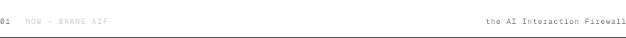
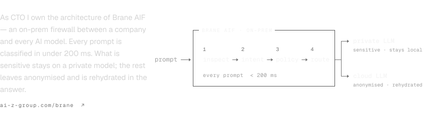
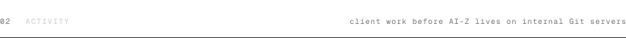
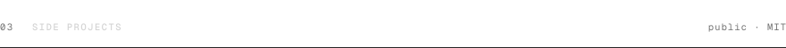
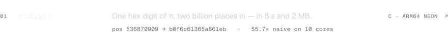
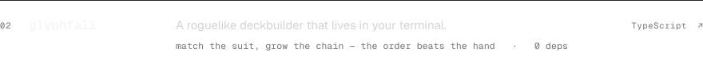
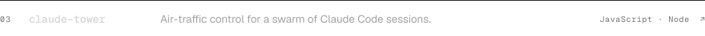
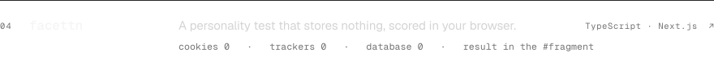
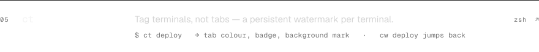
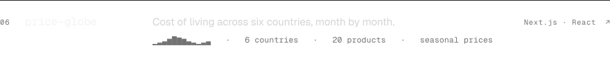

  <picture><source media="(prefers-color-scheme: dark)" srcset="assets/hero-dark.svg"><source media="(prefers-color-scheme: light)" srcset="assets/hero-light.svg"></picture>

  <picture><source media="(prefers-color-scheme: dark)" srcset="assets/s1-dark.svg"><source media="(prefers-color-scheme: light)" srcset="assets/s1-light.svg"></picture>
  <a href="https://ai-z-group.com/en/brane"><picture><source media="(prefers-color-scheme: dark)" srcset="assets/now-dark.svg"><source media="(prefers-color-scheme: light)" srcset="assets/now-light.svg"></picture></a>

  <picture><source media="(prefers-color-scheme: dark)" srcset="assets/s-activity-dark.svg"><source media="(prefers-color-scheme: light)" srcset="assets/s-activity-light.svg"></picture>
  <picture><source media="(prefers-color-scheme: dark)" srcset="https://raw.githubusercontent.com/Lang-Julian/Lang-Julian/output/snake-dark.svg"><source media="(prefers-color-scheme: light)" srcset="https://raw.githubusercontent.com/Lang-Julian/Lang-Julian/output/snake-light.svg"></picture>

  <picture><source media="(prefers-color-scheme: dark)" srcset="assets/s-projects-dark.svg"><source media="(prefers-color-scheme: light)" srcset="assets/s-projects-light.svg"></picture>
  <a href="https://github.com/Lang-Julian/pidigit"><picture><source media="(prefers-color-scheme: dark)" srcset="assets/work-pidigit-dark.svg"><source media="(prefers-color-scheme: light)" srcset="assets/work-pidigit-light.svg"></picture></a> <a href="https://github.com/Lang-Julian/glyphfall"><picture><source media="(prefers-color-scheme: dark)" srcset="assets/work-glyphfall-dark.svg"><source media="(prefers-color-scheme: light)" srcset="assets/work-glyphfall-light.svg"></picture></a> <a href="https://github.com/Lang-Julian/claude-tower"><picture><source media="(prefers-color-scheme: dark)" srcset="assets/work-claude-tower-dark.svg"><source media="(prefers-color-scheme: light)" srcset="assets/work-claude-tower-light.svg"></picture></a> <a href="https://github.com/Lang-Julian/facettn"><picture><source media="(prefers-color-scheme: dark)" srcset="assets/work-facettn-dark.svg"><source media="(prefers-color-scheme: light)" srcset="assets/work-facettn-light.svg"></picture></a> <a href="https://github.com/Lang-Julian/ct"><picture><source media="(prefers-color-scheme: dark)" srcset="assets/work-ct-dark.svg"><source media="(prefers-color-scheme: light)" srcset="assets/work-ct-light.svg"></picture></a> <a href="https://github.com/Lang-Julian/price-globe"><picture><source media="(prefers-color-scheme: dark)" srcset="assets/work-price-globe-dark.svg"><source media="(prefers-color-scheme: light)" srcset="assets/work-price-globe-light.svg"></picture></a>

  <picture><source media="(prefers-color-scheme: dark)" srcset="assets/footer-dark.svg"><source media="(prefers-color-scheme: light)" srcset="assets/footer-light.svg"></picture>

<!-- Generated by scripts/build.py, README included: edit the data there and run
     uv run --no-project --with fonttools --with uharfbuzz python scripts/build.py
     The snake is redrawn daily by .github/workflows/snake.yml onto the output branch. -->
